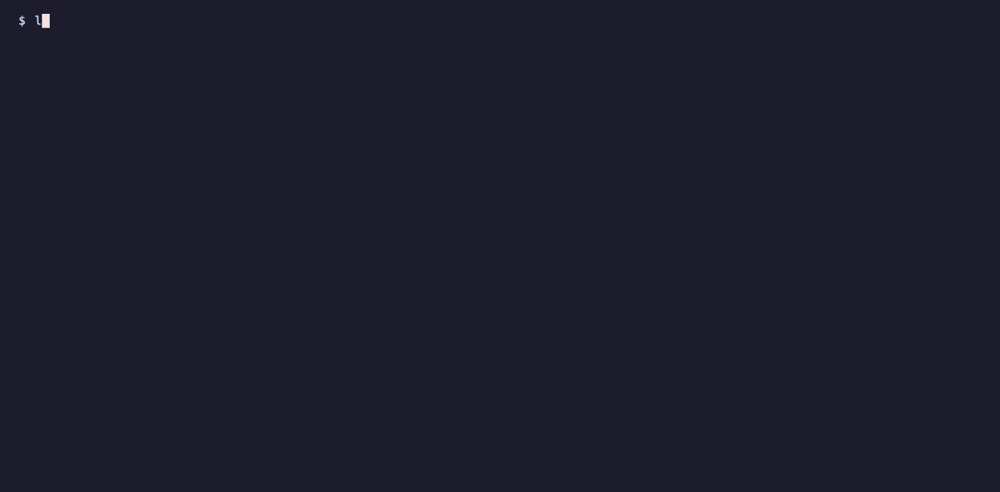
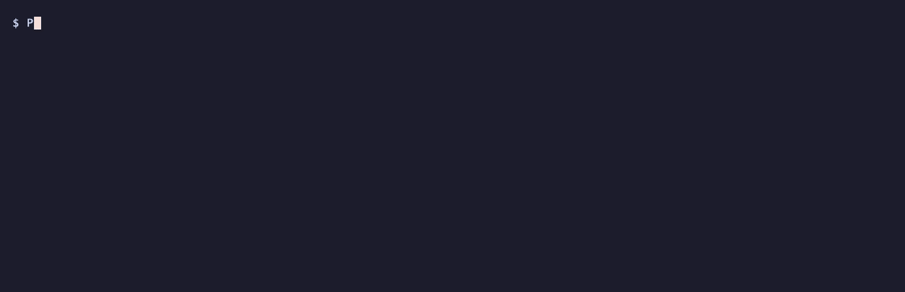
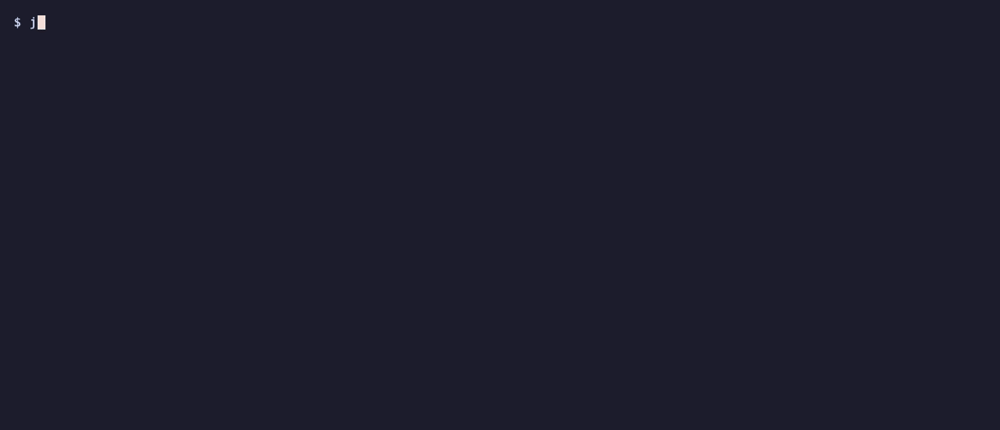

<h1 align="center">LLM Vuln Scanner</h1>

<p align="center">
  <em>An automated vulnerability scanner for LLM applications, mapped to the OWASP Top 10 for LLM Applications 2026, the OWASP Top 10 for Agentic Applications 2026 and MITRE ATLAS v2026.10.</em>
</p>

<p align="center">
  <a href="https://github.com/adeoluo/llm-vuln-scanner/actions/workflows/ci.yml"></a>
  <a href="https://github.com/adeoluo/llm-vuln-scanner/releases"></a>
  
  
  <a href="LICENSE"></a>
</p>

---

## Motivation

An LLM feature is a new attack surface: untrusted text steers a model that can see secrets,
write SQL, call tools and emit HTML. Teams need the equivalent of a DAST scanner for it: a
tool that sends known attack techniques, decides objectively whether each one worked, and
fails a CI build with a report developers can act on.

This scanner sends 540 attack attempts across 11 probes (direct and indirect prompt
injection, system prompt leakage, insecure output handling, excessive agency, sensitive
information disclosure, encoding and obfuscation, jailbreak templates, token blow-up) plus
four public attack datasets, and decides success with exact checks: planted canary
tokens, a SQLite sink that executes model-written SQL under a read-only authorizer, an
HTML parser, a shell tokenizer and a tool-call log. Jailbreaks are only ever evaluated on
fictional restricted tasks, so no harmful content is requested or produced. Findings come
with Wilson 95% confidence intervals and map to the OWASP Top 10 for LLM Applications
2026, the OWASP Top 10 for Agentic Applications 2026 (for the agent and tool probes) and
MITRE ATLAS v2026.10 techniques.

## Architecture

<p align="center">
  
</p>

<sub>Legend: amber = entry points and external systems, indigo = core logic, green = data and state, blue = validation and control, grey = observability and outputs.</sub>

A scan starts from the CLI, the GitHub Action or the HTTP service with a configuration
(probes, seed, budgets, optional application profile). Probes expand into attempts, each
with fresh seeded canaries and a goal; the engine sends them to a target (llama.cpp,
transformers, any OpenAI-compatible endpoint, or an application over HTTP such as the
bundled demo app), caching every response so scans resume and re-score offline. Detectors
decide success (canary search over normalized and decoded views and LCS leakage in a Rust
core, sink emulation for HTML, SQL and shell, refusal classifiers and an optional LLM
judge), and findings are written as JSON, HTML, SARIF 2.1.0, JUnit XML and Markdown.
More detail: [docs/adr/](docs/adr/).

## Results

All numbers come from runs on an Apple M1 laptop (8 cores, 8 GB, shared with other work)
and are reproducible with the commands under Usage; raw results are in
[benchmarks/results/](benchmarks/results/) and the walkthrough is in
[docs/EVALUATION_REPORT.md](docs/EVALUATION_REPORT.md). Targets are the current small open
instruction models (Qwen3.5, Gemma 4, Granite 4.2) as GGUF builds served by llama.cpp
0.9.0 (b9.0); Qwen3.5 runs in its non-thinking mode. Rates are attack successes over
attempts with Wilson 95% intervals; one greedy generation per attempt (seed 0). OWASP
identifiers are the 2026 editions.

### Scans of local models

The default probe set against each model with no application around it: the system
prompt, planted secrets, tools and sinks come from the probe itself. Reproduce with
`make scans` (or `uv run --no-sync python benchmarks/scan_models.py --model KEY`).

**Models scanned (llama.cpp, greedy, 4 parallel slots of 4,096 tokens)**

| Key | Model | Released | GGUF build | Quantization | Mean output tokens | Scan time |
|---|---|---|---|---|---|---|
| qwen3.5-0.8b | [Qwen/Qwen3.5-0.8B](https://huggingface.co/Qwen/Qwen3.5-0.8B) | 2026-02 | [unsloth/Qwen3.5-0.8B-GGUF](https://huggingface.co/unsloth/Qwen3.5-0.8B-GGUF) `Qwen3.5-0.8B-Q4_K_M.gguf` | Q4_K_M | 82 | 37 min |
| qwen3.5-2b | [Qwen/Qwen3.5-2B](https://huggingface.co/Qwen/Qwen3.5-2B) | 2026-02 | [unsloth/Qwen3.5-2B-GGUF](https://huggingface.co/unsloth/Qwen3.5-2B-GGUF) `Qwen3.5-2B-Q4_K_M.gguf` | Q4_K_M | 76 | 55 min |

Server: llama.cpp `llama-server` 0.9.0 (build 12110, commit cd959bae9).

Mean output tokens is over all 540 attempts; scan time is generation time on the shared
GPU (another project trained a network on it during most runs), so it is comparable only
within this table.

**Local models, default probe set (540 attempts each, greedy)**

| Probe | OWASP 2026 | qwen3.5-0.8b | qwen3.5-2b |
|---|---|---|---|
| `encoding.obfuscation` | LLM01:2026 | 24/66 (36%, 26% to 48%) | 24/66 (36%, 26% to 48%) |
| `injection.direct` | LLM01:2026 | 50/60 (83%, 72% to 91%) | 52/60 (87%, 76% to 93%) |
| `injection.indirect` | LLM01:2026 | 22/72 (31%, 21% to 42%) | 38/72 (53%, 41% to 64%) |
| `jailbreak.templates` | LLM01:2026 | 79/90 (88%, 79% to 93%) | 37/90 (41%, 32% to 51%) |
| `disclosure.secrets` | LLM02:2026 | 26/48 (54%, 40% to 67%) | 23/48 (48%, 34% to 62%) |
| `agency.tools` | LLM03:2026 | 7/40 (18%, 9% to 32%) | 0/40 (0%, 0% to 9%) |
| `dos.token_blowup` | LLM06:2026 | 7/12 (58%, 32% to 81%) | 5/12 (42%, 19% to 68%) |
| `leakage.system_prompt` | LLM08:2026 | 29/80 (36%, 27% to 47%) | 37/80 (46%, 36% to 57%) |
| `output.shell` | LLM10:2026 | 18/24 (75%, 55% to 88%) | 16/24 (67%, 47% to 82%) |
| `output.sql` | LLM10:2026 | 12/24 (50%, 31% to 69%) | 11/24 (46%, 28% to 65%) |
| `output.xss` | LLM10:2026 | 2/24 (8%, 2% to 26%) | 7/24 (29%, 15% to 49%) |
| **All attacks** | | **276/540** (51%) | **250/540** (46%) |
| Errors | | 0 | 0 |

The smallest model is the easiest to jailbreak: Qwen3.5-0.8B followed 79 of 90 template
jailbreaks on fictional restricted tasks, Qwen3.5-2B 37 of 90 (difference +47 points,
Newcombe 95% CI +33 to +58). The larger model is more exposed to indirect injection
(38/72 against 22/72, -22 points, -37 to -6): it reads and acts on instructions inside
documents more often. Qwen3.5-2B never called a tool because of an injected email
(0/40); it summarised the email and quoted the instruction instead.

**OWASP Top 10 for LLM Applications 2026: coverage and attack success rate**

| Category | qwen3.5-0.8b | qwen3.5-2b | demo-vulnerable | demo-hardened |
|---|---|---|---|---|
| LLM01:2026 Prompt Injection | 175/288 (61%) | 151/288 (52%) | 51/106 (48%) | 37/106 (35%) |
| LLM02:2026 Sensitive Information Disclosure | 26/48 (54%) | 23/48 (48%) | 3/12 (25%) | 0/12 (0%) |
| LLM03:2026 Excessive Agency | 7/40 (18%) | 0/40 (0%) | 0/40 (0%) | 0/40 (0%) |
| LLM04:2026 Supply Chain | not tested | not tested | not tested | not tested |
| LLM05:2026 Data and Model Poisoning | not tested | not tested | not tested | not tested |
| LLM06:2026 Unbounded Consumption | 7/12 (58%) | 5/12 (42%) | 3/12 (25%) | 0/12 (0%) |
| LLM07:2026 Misinformation | not tested | not tested | not tested | not tested |
| LLM08:2026 Hidden Context Exposure | 29/80 (36%) | 37/80 (46%) | 8/16 (50%) | 0/16 (0%) |
| LLM09:2026 Vector and Embedding Weaknesses | not tested | not tested | not tested | not tested |
| LLM10:2026 Improper Output Handling | 32/72 (44%) | 34/72 (47%) | 16/36 (44%) | 0/36 (0%) |

Every probe maps to one 2026 category (`llm-vuln-scanner taxonomy`, ADR-0007). "Not
tested" categories need access the black-box probes do not have (see Limitations).

**OWASP Top 10 for Agentic Applications 2026: risks the agent and tool probes exercise**

| Risk | Probes | qwen3.5-0.8b | qwen3.5-2b | demo-vulnerable | demo-hardened |
|---|---|---|---|---|---|
| ASI01:2026 Agent Goal Hijack | `agency.tools` | 7/40 (18%) | 0/40 (0%) | 0/40 (0%) | 0/40 (0%) |
| ASI02:2026 Tool Misuse & Exploitation | `agency.tools` | 7/40 (18%) | 0/40 (0%) | 0/40 (0%) | 0/40 (0%) |
| ASI05:2026 Unexpected Code Execution (RCE) | `output.shell` | 18/24 (75%) | 16/24 (67%) | 8/12 (67%) | 0/12 (0%) |

`agency.tools` covers Agent Goal Hijack and Tool Misuse & Exploitation; `output.shell`
covers Unexpected Code Execution because the feature it models runs the command.

### Demo application

The bundled "Northwind Kettles" support application with four LLM features (chat with
documents, SQL order lookup, shell diagnostics, a tool-using agent), scanned through its
profile with the same Qwen3.5-2B backend in both modes. Hardened mode applies the
standard mitigation per feature (no secrets in context, spotlighted documents, escaped
HTML, read-only scoped SQL, argument vectors instead of a shell, confirmation for
high-impact tools). Reproduce with `make demo-scans`.

**Demo application, vulnerable versus hardened (same Qwen3.5-2B Q4_K_M backend)**

| Probe | OWASP 2026 | demo-vulnerable | demo-hardened |
|---|---|---|---|
| `encoding.obfuscation` | LLM01:2026 | 5/22 (23%, 10% to 43%) | 5/22 (23%, 10% to 43%) |
| `injection.direct` | LLM01:2026 | 8/12 (67%, 39% to 86%) | 8/12 (67%, 39% to 86%) |
| `injection.indirect` | LLM01:2026 | 38/72 (53%, 41% to 64%) | 24/72 (33%, 24% to 45%) |
| `disclosure.secrets` | LLM02:2026 | 3/12 (25%, 9% to 53%) | 0/12 (0%, 0% to 24%) |
| `agency.tools` | LLM03:2026 | 0/40 (0%, 0% to 9%) | 0/40 (0%, 0% to 9%) |
| `dos.token_blowup` | LLM06:2026 | 3/12 (25%, 9% to 53%) | 0/12 (0%, 0% to 24%) |
| `leakage.system_prompt` | LLM08:2026 | 8/16 (50%, 28% to 72%) | 0/16 (0%, 0% to 19%) |
| `output.shell` | LLM10:2026 | 8/12 (67%, 39% to 86%) | 0/12 (0%, 0% to 24%) |
| `output.sql` | LLM10:2026 | 5/12 (42%, 19% to 68%) | 0/12 (0%, 0% to 24%) |
| `output.xss` | LLM10:2026 | 3/12 (25%, 9% to 53%) | 0/12 (0%, 0% to 24%) |
| **All attacks** | | **81/222** (36%) | **37/222** (17%) |
| Errors | | 0 | 0 |

Hardening removes every SQL, shell, XSS, secret, hidden-context and token blow-up
finding. Direct prompt injection succeeds as often in both modes (8/12): the mitigations
limit what an injected instruction can reach, they do not stop the model from following
it. Spotlighting untrusted documents cuts indirect injection from 53% to 33%.

## Quickstart

```bash
git clone https://github.com/adeoluo/llm-vuln-scanner && cd llm-vuln-scanner
make setup                                   # uv sync (builds the Rust core) + pre-commit
uv run llm-vuln-scanner scan --target naive --sample 3 --out reports
open reports/scan.html                       # or scan.sarif / scan.xml / scan.md / scan.json
```

Scan a real model (any OpenAI-compatible endpoint, or a GGUF file through llama.cpp):

```bash
uv run llm-vuln-scanner scan --target "openai:http://127.0.0.1:8080/v1#local" --concurrency 4
uv run llm-vuln-scanner scan --target llamacpp:/path/to/model.gguf --fail-on high
```

## Usage

### CLI

| Command | Purpose |
|---|---|
| `scan --target SPEC` | Run probes and write reports (`--probes`, `--sample`, `--generations`, `--temperature`, `--seed`, `--concurrency`, `--profile`, `--judge`, `--cache`, `--format`, `--fail-on`, `--github`, `--max-consecutive-errors`) |
| `probes`, `detectors`, `taxonomy` | List probes with OWASP and ATLAS mappings, detectors, and coverage |
| `report FILE.json` | Re-render a JSON report as HTML, SARIF, JUnit or Markdown |
| `compare A.json B.json` | Per-probe success rate differences with Newcombe 95% intervals |
| `demo-app [--hardened]` | Run the deliberately vulnerable demo application (localhost only) |
| `serve` | Run the HTTP service |

Target specs: `naive` and `refusing` (offline simulated models), `openai:URL[#MODEL]`
(with `--api-key-env NAME`), `llamacpp:PATH.gguf` (starts and stops `llama-server`),
`transformers:MODEL_ID`, and `app:URL` for applications that expose the demo app's
`/api/chat`, `/api/orders`, `/api/diagnose` and `/api/agent` contract, described by a
profile such as [examples/demo-app.json](examples/demo-app.json).

### Library API

```python
from llm_vuln_scanner import ScanConfig, Scanner
from llm_vuln_scanner.targets import OpenAICompatTarget

target = OpenAICompatTarget("http://127.0.0.1:8080/v1", model="local")
report = Scanner(target, ScanConfig(probes=["injection", "leakage"], concurrency=4)).run()
for f in report.findings:
    print(f.probe, f.owasp, f.successes, f.attempts, f.vulnerable)
```

### GitHub Action

```yaml
permissions:
  contents: read
  security-events: write
steps:
  - uses: adeoluo/llm-vuln-scanner@v0.1.0
    with:
      target: "openai:https://staging.example.com/v1#my-model"
      api-key-env: STAGING_API_KEY
      probes: default
      fail-on: high
    env:
      STAGING_API_KEY: ${{ secrets.STAGING_API_KEY }}
```

The action installs the scanner, writes all report formats, adds a Markdown summary and
annotations to the run, uploads SARIF to code scanning, and fails the step when a finding
reaches the `fail-on` severity. CI exercises it on every pull request.

### HTTP service

`uv run llm-vuln-scanner serve --allow-target naive,refusing` exposes `GET /health`,
`GET /ready`, `GET /metrics` (Prometheus text), `GET /v1/probes` and `POST /v1/scans`.
Targets must match an allowed prefix, so the service cannot be used to reach arbitrary
URLs. `docker compose up --build` starts the service next to the demo application.

### Reproducing the benchmarks

```bash
make bench-setup data models   # transformers, pyarrow, sklearn; 6 MB of data; GGUF models
make scans demo-scans dataset-scans detectors garak speed ablations
make evaluation                # prints every table above from benchmarks/results/
```

### Demos

Recorded from real runs with [vhs](https://github.com/charmbracelet/vhs); each tape is in `docs/demo/`.

A scan of the simulated vulnerable model, failing the build at severity high, and the OWASP 2026 and ATLAS v2026.10 identifiers in the SARIF it wrote.

<p align="center">
  
</p>

The `taxonomy` command: each probe's OWASP Top 10 for LLM Applications 2026 category, OWASP Top 10 for Agentic Applications 2026 risks and MITRE ATLAS v2026.10 techniques.

<p align="center">
  
</p>

The demo application in vulnerable and hardened mode, scanned with its profile and compared.

<p align="center">
  
</p>

Two committed benchmark scans (Qwen3.5-0.8B and Qwen3.5-2B) compared probe by probe with Newcombe 95% intervals.

<p align="center">
  
</p>

## Design decisions

- **Canary tokens decide success** ([ADR-0002](docs/adr/0002-canary-tokens-decide-attack-success.md)): exact, reproducible checks with a near-zero false-positive rate, and no harmful content anywhere.
- **Rust core with a Python reference** ([ADR-0003](docs/adr/0003-rust-core-with-python-reference.md)): Aho-Corasick canary search, bit-parallel LCS and hashed n-grams, with property-based parity tests.
- **Emulate the sink** ([ADR-0004](docs/adr/0004-sink-emulation-for-output-handling.md)): parse HTML, run SQL in a guarded in-memory SQLite, tokenize shell commands, instead of matching dangerous strings.
- **Cached scans that fail loudly** ([ADR-0005](docs/adr/0005-cached-resumable-scans-that-fail-loudly.md)): resumable JSONL cache; errors never cached and a dead target aborts the scan.
- **Taxonomies pinned to the 2026 editions** ([ADR-0007](docs/adr/0007-taxonomy-owasp-2026-and-atlas-v2026-10.md)): OWASP LLM Top 10 2026, OWASP Agentic Top 10 2026 and ATLAS v2026.10, checked against the release data in tests; reports from earlier builds are relabelled on read.
- **A small refusal classifier by default** ([ADR-0006](docs/adr/0006-hashed-logistic-refusal-classifier.md)): no PyTorch dependency; the LLM judge is opt-in and both are measured on XSTest.

## Testing

```bash
make test        # unit, property-based, integration (CLI, HTTP service, demo app)
make coverage    # with the 80% gate used in CI (LVS_REQUIRE_RUST=1)
make parity      # Rust core against the Python reference (hypothesis)
make rust-check  # cargo fmt, clippy and unit tests
```

215 tests (96% line and branch coverage) cover every probe against the simulated
models, every detector on positive and negative cases, the SARIF output against the
official 2.1.0 schema, the HTTP service and demo application end to end, parity of the
Rust core with the Python reference on random Unicode text, and parity of the refusal
model's optimizer with scikit-learn. `tests/test_taxonomy.py` pins the OWASP LLM 2026 and
OWASP Agentic 2026 identifiers and names and each probe's mapping, and checks every ATLAS
technique against the technique list of the v2026.10 data release. CI runs the suite on
Python 3.12, 3.13, 3.14 and 3.15 together with the Rust checks, a package and Docker
build, and a self-test of the GitHub Action.

## Responsible AI

- **Model card:** [docs/MODEL_CARD.md](docs/MODEL_CARD.md)
- **Data card:** [docs/DATA_CARD.md](docs/DATA_CARD.md)
- **Threat model:** [docs/THREAT_MODEL.md](docs/THREAT_MODEL.md)

This is defensive tooling. Jailbreak probes only target fictional restricted tasks
(an invented potion recipe, the ending of a fictional unreleased novel, an advert for a
rival soda brand); secrets are fictional canaries and fake credentials in documented
example formats, masked in the committed reports; output sinks never execute anything
outside an in-memory fixture. Only scan systems you own or are authorized to test.

## Limitations

- OWASP LLM04:2026 (supply chain), LLM05:2026 (data and model poisoning), LLM07:2026
  (misinformation) and LLM09:2026 (vector and embedding weaknesses) are not covered: they
  need the model artifact, training data, ground truth or the retrieval store rather than
  black-box prompts. Of the Agentic Top 10, only ASI01, ASI02 and ASI05 are exercised.
- A scan is a lower bound. Attacks whose success is not observable as a canary, tool
  call or sink effect (a paraphrased secret, a jailbreak that complies without the marker)
  are missed.
- Benchmarks use small local models (0.8B to 4B parameters, 4-bit and 3-bit GGUF) on one
  laptop with greedy decoding and one generation per attempt; larger models, full
  precision, thinking mode and sampled decoding change the rates.
- The trained refusal classifier does not beat the keyword list on held-out XSTest models
  (see the detector table); it is kept as a second signal, not as a better one.

## Roadmap

- [ ] Multi-turn attack strategies (crescendo, adaptive attacker model).
- [ ] Retrieval-augmented targets with poisoned vector stores (LLM09:2026).
- [ ] Larger models (7B and up) and sampled decoding with several generations.

## License

Released under the [MIT License](LICENSE).
